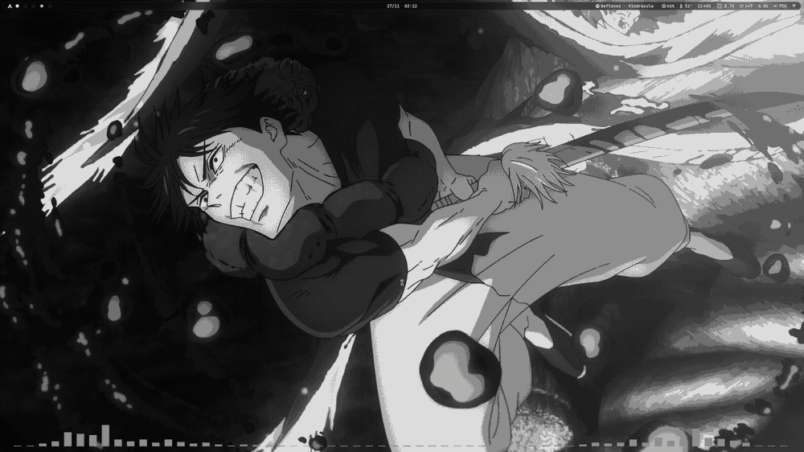
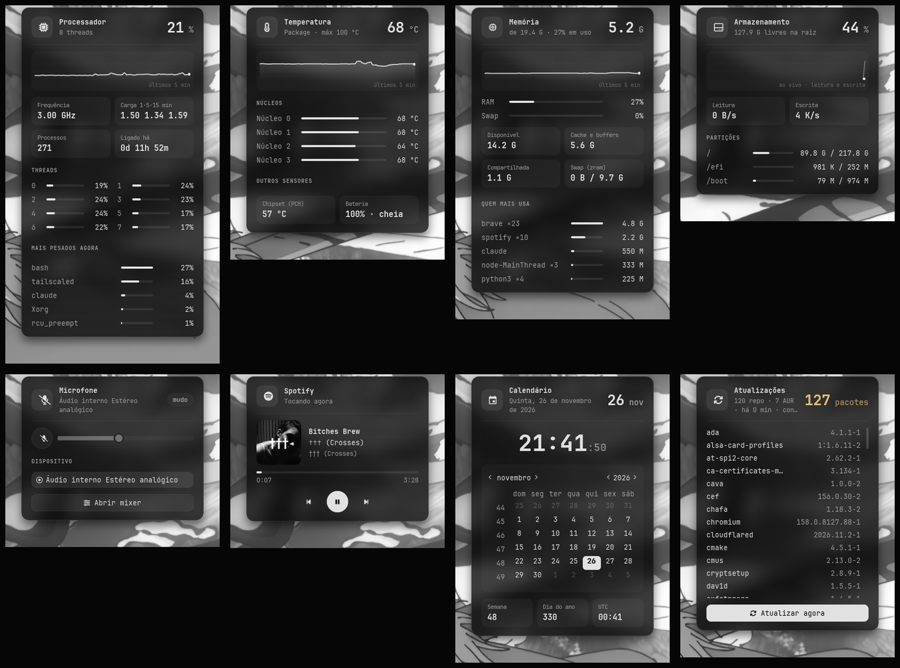

<div align="center">
    
</div><br>

<div align="center">

## /dotfiles

</div>

<div align="center">
<table>
<tr>
<td>

```Go
†††    setup / hyprland     †††
-------------------------------
╭─ distro      -> arch linux
├─ editor      -> neovim
├─ browser     -> brave
├─ shell       -> zsh
╰─ monitor     -> barpop

╭─ music       -> cmus, spotify
├─ compositor  -> built-in
├─ notify      -> dunst
├─ media       -> mpv
├─ background  -> cava
╰─ files       -> ranger

╭─ wm          -> hyprland (lua config)
├─ bar         -> waybar
├─ terminal    -> kitty
├─ launcher    -> fuzzel
├─ wallpaper   -> awww
├─ lock        -> gtk-session-lock + webkit
├─ theme       -> pywal, b&w
╰─ font        -> jetbrainsmono
```

</td>
</tr>
</table>
</div>

<div align="center">
    
</div>


  **warning**

  this is my personal arch linux setup, running on three monitors. use it as inspiration: there is no guarantee it will work as-is on your machine.

<br>

<details>
<summary><b>keybinds 麗</b></summary>
<br>

| Keybind | Action |
|---------|--------|
| `Super + Enter` | Open Kitty |
| `Super + P` | Open Fuzzel |
| `Super + 1–5` | Switch workspace on the focused monitor |
| `Super + Shift + Q` | Close window |
| `Super + G` | Toggle glass effects |
| `Ctrl + Shift + A / S` | More / less transparency |
| `Print` / `Super + Print` / `Shift + Print` | Copy region / save full screenshot / copy text (OCR) |
| `Super + Shift + Y` | Clipboard history |
| `Super + F11` | Lock screen |

</details>

<div align=center>

```ocaml
††† barpop 窓
```
</div>

<p align="center">
    
</p>

Waybar blocks open GTK layer-shell popups through `barpop`. Cava pulses behind the windows.

<details>
<summary><b>what each popup shows 火</b></summary>
<br>

| Block | Popup |
|-------|-------|
| CPU | 5-minute graph, frequency, load, processes, uptime, per-thread bars and the 5 heaviest processes right now |
| Temperature | 5-minute graph, every core with its bar, chipset and battery |
| Memory | 5-minute graph, RAM and swap, cache and the 5 programs using the most |
| Disk | live read/write graph and space of every partition |
| Updates | package list (repo + AUR) with the new version, scrollable, and an *Update now* button |
| Volume / Mic | volume slider, mute button, device picker and a shortcut to the mixer |
| Network | live download/upload, latency, Wi-Fi signal and router |
| VPN | Mullvad state with connect/disconnect, Tailscale and the devices on the tailnet |
| cmus / Spotify | song, artist, cover, progress and controls |
| Date | big clock, calendar with week numbers and UTC time |

</details>

<details>
<summary><b>how it works 水</b></summary>
<br>

- It opens under the block you clicked. The mouse position is read before GTK loads, so moving the mouse right after the click doesn't throw it off.
- Click the same block again to close it, or another block to swap. Moving the mouse away also closes it.
- Kitty and barpop share opacity through `~/.cache/st-alpha`. Hyprland handles blur and fades.
- Colors follow pywal.
- The CPU, temperature and memory blocks save their last 60 values (5 minutes) to `$XDG_RUNTIME_DIR/barhist/`, so the graphs already have data when the popup opens.
- The updates block caches the package list. The popup shows the cached list at once and runs `checkupdates` and `yay -Qua` again in the background.

</details>

<p align="center">
    
</p>
<br>

<div align=center>

```ocaml
††† installation 魅
```
</div>

<details>
<summary><b>manual</b></summary>
<br>

```sh
sudo pacman -S --needed hyprland waybar kitty fuzzel awww grim slurp \
  wl-clipboard cliphist hyprlock hyprsunset hyprpicker hyprpolkitagent \
  gtk-layer-shell gtk-session-lock webkit2gtk-4.1 gtk3 python-gobject \
  cava dunst tesseract tesseract-data-eng tesseract-data-por playerctl \
  pipewire wireplumber python-pywal imagemagick zsh ttf-jetbrains-mono-nerd
```

From the repository root, link the configuration and scripts you want to use.

```sh
repo="$(pwd -P)"
mkdir -p "$HOME/.config" "$HOME/.local/bin"
for config in hypr waybar fuzzel cava kitty dunst; do
    ln -sT "$repo/.config/$config" "$HOME/.config/$config"
done
for script in wayland hypr menu-energia print-area fundo-wayland cava-fundo clip-historico alpha-terminal trocar-sessao barpop; do
    ln -sT "$repo/.local/bin/$script" "$HOME/.local/bin/$script"
done
```

Start the session with `~/.local/bin/hypr` from a TTY. Adjust outputs in
`hyprland.lua` and link the remaining shared scripts and configs as needed.
The custom lock screen also uses `trava-saver` and `auth_trava`.

</details>


