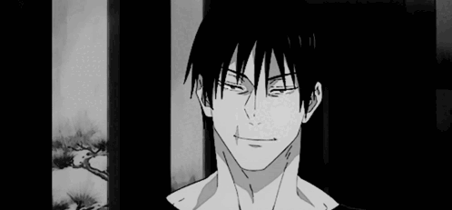
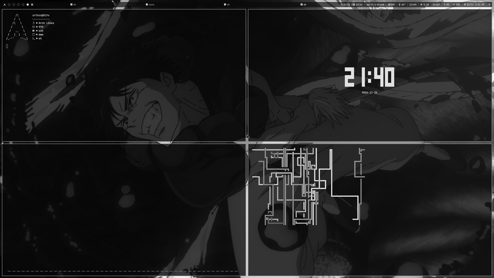
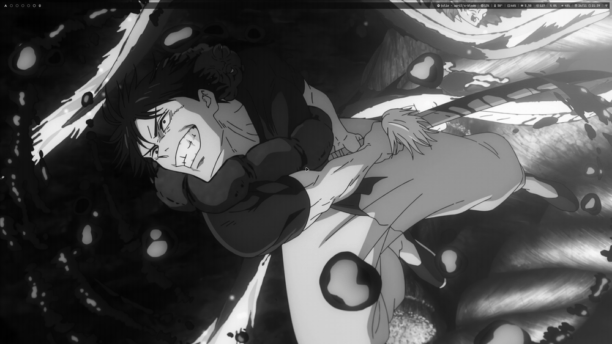
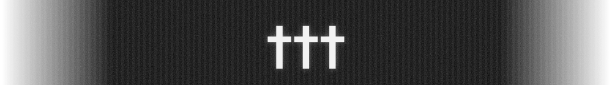

<div align="center">
    
</div><br>

<div align="center">

## /home/arthos/dotfiles

</div>

<div align=center>


</div>



```Go
†††                 setup / dwm                 †††
---------------------------------------------------
╭─ distro          -> arch linux
├─ editor          -> neovim
├─ browser         -> chromium / brave
├─ shell           -> zsh
╰─ system monitor  -> barpop

╭─ music           -> cmus / spotify
├─ compositor      -> picom (glass + blur)
├─ notifications   -> dunst
├─ media player    -> mpv
╰─ file manager    -> ranger

╭─ wm              -> dwm
├─ bar             -> dwmblocks-async
├─ terminal        -> st
├─ app launcher    -> dmenu
├─ theme           -> pywal (black & white toji)
╰─ font            -> jetbrainsmono nf
```

<p align="center">
    
</p>
<br>

  **warning**

  this is my personal arch linux setup, running on three monitors. use it as inspiration: there is no guarantee it will work as-is on your machine.

<br>

<div align=center>

```ocaml
††† barpop 窓
```
</div>

<p align="center">
    
</p>

Click a block on the bar and it opens a popup. A single script, `~/.local/bin/barpop` (Python + GTK 3), draws all of them. The data comes from `/proc`, `/sys` and tools like `wpctl`, `iw` and `df`; btop and htop are not needed.

<details>
<summary><b>what each popup shows 火</b></summary>
<br>

| Block | Popup |
|-------|-------|
| CPU | 5-minute graph, frequency, load, processes, uptime, per-thread bars and the 5 heaviest processes right now |
| Temperature | 5-minute graph, every core with its bar, chipset and battery |
| Memory | 5-minute graph, RAM and swap, cache and the 5 programs using the most |
| Disk | live read/write graph and space of every partition |
| Updates | package list (repo + AUR) with the new version, scrollable, and an *Update now* button |
| Volume / Mic | volume slider, mute button, device picker and a shortcut to the mixer |
| Network | live download/upload, latency, Wi-Fi signal, local IP and router |
| VPN | Mullvad state with connect/disconnect, Tailscale and the devices on the tailnet |
| cmus / Spotify | song, artist, cover, progress and controls |
| Date | big clock, calendar with week numbers and UTC time |

</details>

<details>
<summary><b>how it works 水</b></summary>
<br>

- It opens under the block you clicked. The mouse position is read before GTK loads, so moving the mouse right after the click doesn't throw it off.
- Click the same block again to close it, or another block to swap. Moving the mouse away also closes it.
- The background uses the same transparency as `st` (`~/.cache/st-alpha`), so `Ctrl` + `Shift` + `A` / `S` changes both. picom adds blur, shadow, round corners and fade to these popups only (`class_g = 'Barpop'`). With picom off (`Super` + `G`) the background is solid.
- Background and text colors come from `xrdb`, like `st`. The font size is the GTK default.
- The CPU, temperature and memory blocks save their last 60 values (5 minutes) to `$XDG_RUNTIME_DIR/barhist/`, so the graphs already have data when the popup opens.
- The updates block caches the package list. The popup shows the cached list at once and runs `checkupdates` and `yay -Qua` again in the background.

</details>

<p align="center">
    
</p>
<br>

<div align=center>

```ocaml
††† installation 魅
```
</div>

<details>
<summary><b>manual</b></summary>
<br>

  Assuming your **AUR Helper** is [yay](https://github.com/Jguer/yay).

```sh
yay -S cava devour exa tty-clock-git picom cmatrix-git pipes.sh npm xdotool xautolock betterlockscreen yad libnotify wal-telegram-git python-pywalfox xsettingsd themix-gui-git pacman-contrib ripgrep fd luarocks v4l2loopback-dkms themix-theme-oomox-git archdroid-icon-theme tesseract-data-eng tesseract-data-por slop arandr polkit-gnome clipmenu zsh openrgb cmus mpd mpc ncmpcpp playerctl dbus simple-mtpfs dunst emacs feh ffmpeg ffmpegthumbnailer firefox flameshot pcmanfm gvfs fzf git gnu-free-fonts go gd btop mullvad-vpn-bin imagemagick mpv neofetch neovim noto-fonts noto-fonts-cjk noto-fonts-emoji numlockx obs-studio openssh perl pulsemixer udiskie keepassxc python-pip python-pywal qalculate-gtk android-tools xarchiver xdg-user-dirs qutebrowser ranger syncthing sxiv telegram-desktop tree ttf-jetbrains-mono-nerd ttf-font-awesome qbittorrent gpick ueberzugpp redshift p7zip unrar unzip epub-thumbnailer-git python-pdftotext poppler xorg-xinput vim webkit2gtk-4.1 xclip yt-dlp zathura zathura-pdf-mupdf zip xorg-server xorg-xinit libx11 libxinerama libxft base base-devel qt5ct qt6ct libreoffice-fresh pipewire pipewire-alsa pipewire-pulse pipewire-jack wireplumber xorg-xwininfo scrcpy bibata-cursor-theme-bin nodejs cloudflared python python-cryptography sqlite nftables ddcutil net-tools iputils usbutils
```

```sh
git clone https://github.com/francosec/dotfiles.git
```

  Create [symbolic links](https://www.freecodecamp.org/news/linux-ln-how-to-create-a-symbolic-link-in-linux-example-bash-command/) to the files/directories you need.

</details>

<details>
<summary><b>automatic</b></summary>
<br>

  Install [git](https://github.com/git/git), clone this repo and run the script

```sh
sudo pacman -Syu git
git clone https://github.com/francosec/dotfiles.git
cd dotfiles/
chmod +x install.sh
./install.sh
```

</details>

<details>
<summary><b>fresh arch with luks</b></summary>
<br>

  `instalar-arch-luks.sh` installs Arch with two LUKS2 volumes (`/boot`, opened by GRUB, and `/`, opened by the initramfs), then runs this build at the end. Run it from the Arch live ISO.

```sh
bash instalar-arch-luks.sh /dev/sdX   # WIPES the whole disk
```

  Pass the disk, or set `MODELO_ALVO` to pick it by model. It refuses any disk with an NTFS partition.

</details>

<br>

<div align=center>
  
```ocaml
††† suckless build お
```
<br>
</div>

<details>
<summary><b>DWM Patches 火</b></summary>
<br>  
<table>
  <tr>
    <td>
      <a href="https://dwm.suckless.org/patches/xresources/">
        <p title="Allows to handle settings from Xresources."><kbd>xresources</kbd></p>
      </a>
    </td>
    <td>
      <a href="https://dwm.suckless.org/patches/vanitygaps/">
        <p title="Adds gaps between client windows.
        Add cfacts patch.
        Adds layouts: spiral, dwindle, bstack, bstackhoriz
        nrowgrid, horizgrid, gaplessgrid, centeredmaster
            centeredfloatingmaster, grid, deck"><kbd>vanitygapscombo</kbd></p>
      </a>
    </td>
    <td>
      <a href="https://dwm.suckless.org/patches/alpha/">
        <p title="Allow dwm to have translucent bars, while keeping all the text on it opaque."><kbd>alpha</kbd></p>
      </a>
    </td>
    <td>
      <a href="https://dwm.suckless.org/patches/preserveonrestart/">
        <p title="Preserves clients on old tags."><kbd>preserveonrestart</kbd></p>
      </a>
    </td>
    <td>
      <a href="https://dwm.suckless.org/patches/movestack/">
        <p title="Allows you to move clients around in the stack and swap them with the master."><kbd>movestack</kbd></p>
      </a>
    </td>
    <td>
      <a href="https://dwm.suckless.org/patches/bar_height/">
        <p title="This patch allows user to change dwm's default bar height."><kbd>barheight</kbd></p>
      </a>
    </td>
    <td>
      <a href="https://dwm.suckless.org/patches/togglefloatingcenter/">
        <p title="This patch will allows you to toggle floating window client will be centered position."><kbd>togglefloatingcenter</kbd></p>
      </a>
    </td>
  </tr>
  <tr>
    <td>
      <a href="https://dwm.suckless.org/patches/statuscmd/">
        <p title="This patch adds the ability to signal a status monitor."><kbd>statuscmd</kbd></p>
      </a>
    </td>
    <td>
      <a href="https://dwm.suckless.org/patches/statusallmons/">
        <p title="Draws and updates the statusbar on all monitors."><kbd>statusallmons</kbd></p>
      </a>
    </td>
    <td>
      <a href="https://dwm.suckless.org/patches/swallow/">
        <p title='Adds "window swallowing" to dwm.'><kbd>swallow</kbd></p>
      </a>
    </td>
    <td>
      <a href="https://dwm.suckless.org/patches/alttagsdecoration/">
        <p title="Provides the ability to use an alternative text for tags which contain at least one window."><kbd>alttagsdecoration</kbd></p>
      </a>
    </td>
     <td>
      <a href="https://dwm.suckless.org/patches/save_floats/">
        <p title="This patch saves size and position of every floating window before it is forced into tiled mode."><kbd>savefloats</kbd></p>
      </a>
    </td>
    <td>
      <a href="https://dwm.suckless.org/patches/resizecorners/">
        <p title="The mouse is warped to the nearest corner and you resize it from there."><kbd>resizecorners</kbd></p>
      </a>
    </td>
    <td>
      <a href="https://dwm.suckless.org/patches/focusonnetactive/">
        <p title="Patch to activate window instead of urgency."><kbd>focusonnetactive</kbd></p>
      </a>
    </td>
  </tr>
  <tr>
    <td>
      <a href="https://dwm.suckless.org/patches/winicon/">
        <p title="A patch that enables dwm to show window icons."><kbd>winicon</kbd></p>
      </a>
    </td>
    <td>
      <a href="https://dwm.suckless.org/patches/awesomebar/">
        <p title="This patch changes the taskbar to be more like awesome."><kbd>awesomebar</kbd></p>
      </a>
    </td>
    <td>
      <a href="https://dwm.suckless.org/patches/noborder/">
        <p title="Remove the border when there is only one window visible."><kbd>noborder</kbd></p>
      </a>
    </td>
    <td>
      <a href="https://dwm.suckless.org/patches/centeredwindowname/">
        <p title="Center the WM_NAME of the currently selected window on the status bar."> <kbd>centeredwindowname</kbd></p>
      </a>
    </td>
    <td>
      <a href="https://dwm.suckless.org/patches/exitmenu/">
        <p title="Simple exit menu for dwm."><kbd>exitmenu</kbd></p>
      </a>
    </td>
    <td>
      <a href="https://dwm.suckless.org/patches/windowmap/">
        <p title="This patch makes the windows get mapped or unmapped in Xorg. Fixing black screen when switch back to a fullscreen service."><kbd>windowmap</kbd></p>
      </a>
    </td>
    <td>
      <a href="https://dwm.suckless.org/patches/underlinetags/">
        <p title="Underlines selected tags."><kbd>underlinetags</kbd></p>
      </a>
    </td>
  </tr>
  <tr>
    <td>
      <a href="https://dwm.suckless.org/patches/statusbutton/">
        <p title="Adds a clickable button to the left hand side of the statusbar."><kbd>statusbutton</kbd></p>
      </a>
    </td>
    <td>
      <a href="https://dwm.suckless.org/patches/scratchpads/">
        <p title="Enables multiple scratchpads."><kbd>scratchpads</kbd></p>
      </a>
    </td>
     <td>
      <a href="https://dwm.suckless.org/patches/pertag/">
        <p title="Keeps layout, mwfact, barpos and nmaster per tag."><kbd>pertag</kbd></p>
      </a>
    </td>
    <td>
      <a href="https://dwm.suckless.org/patches/attachdirection/">
        <p title="Attachdirection is a merge of:
        attachabove
        attachaside
        attachbelow
        attachbottom
        attachtop."><kbd>attachdirection</kbd></p>
      </a>
    </td>
        <td>
      <a href="https://github.com/bakkeby/patches/blob/master/dwm/dwm-placemouse-6.2.diff">
        <p title="This patch allows you to move windows with the mouse without switching to floating mode."><kbd>placemouse</kbd></p>
      </a>
    </td>
    <td>
      <a href="https://dwm.suckless.org/patches/moveresize/">
        <p title="This patch allows you to move and resize dwm's clients using keyboard bindings."><kbd>moveresize</kbd></p>
      </a>
    </td>
    <td>
      <a href="https://dwm.suckless.org/patches/dynamicscratchpads/">
        <p title="This patch allows for the management of scratchpad windows dynamically."><kbd>dynamicscratchpads</kbd></p>
      </a>
    </td>
  </tr>
  <tr>
    <td>
      <a href="https://dwm.suckless.org/patches/floatrules/">
        <p title="Adds 5 extra variables to the 'rules' array in config.def.h."><kbd>floatrules</kbd></p>
      </a>
    </td>
    <td>
      <a href="https://dwm.suckless.org/patches/barpadding/">
        <p title="Adds variables for verticle and horizontal space between the statusbar."><kbd>barpadding</kbd></p>
      </a>
    </td>
    <td>
      <a href="https://dwm.suckless.org/patches/sticky/">
        <p title="A sticky client is visible on all tags."><kbd>sticky</kbd></p>
      </a>
    </td>
    <td>
      <a href="https://dwm.suckless.org/patches/stickyindicator/">
        <p title="Adds indicator in their bar to show when a window is sticky."><kbd>stickyindicator</kbd></p>
      </a>
    </td>
    <td>
      <a href="https://github.com/bakkeby/patches/blob/master/dwm/dwm-dragfact-6.3.diff">
        <p title="Allows resizing of windows with the mouse."><kbd>dragfact</kbd></p>
      </a>
    </td>
    <td>
      <a href="https://dwm.suckless.org/patches/tag-previews/">
        <p title="Allows you to see the contents of an already viewed tag."><kbd>tagpreview</kbd></p>
      </a>
    </td>
    <td>
      <a href="https://dwm.suckless.org/patches/hide_vacant_tags/">
        <p title="This patch prevents dwm from drawing tags with no clients on the bar."><kbd>hidevacanttags</kbd></p>
      </a>
    </td>
  </tr>
  <tr>
    <td>
      <a href="https://github.com/bakkeby/patches/blob/master/dwm/dwm-riodraw-nopidmatching-6.3_full.diff">
        <p title="Adding rio-like draw-to-resize windows."><kbd>riodraw</kbd></p>
      </a>
    </td>
    <td>
      <a href="https://dwm.suckless.org/patches/layoutmenu/">
        <p title="Adds a context menu for layout switching."><kbd>layoutmenu</kbd></p>
      </a>
    </td>
    <td>
      <a href="https://dwm.suckless.org/patches/center/">
        <p title="Add an iscentered rule to automatically center clients."><kbd>center</kbd></p>
      </a>
    </td>
     <td>
      <a href="https://dwm.suckless.org/patches/systray/">
        <p title="A simple system tray implementation."><kbd>systray</kbd></p>
      </a>
    </td>

  </tr>
</table>
  
  **Note**
 
  Hover over the patch to receive information about it.
  
</details>
<details>
<summary><b>ST Patches 水</b></summary>
<br>  
<table>
    <td>
      <a href="https://st.suckless.org/patches/xresources/">
        <p title="Adds the ability to configure st via Xresources."><kbd>xresources</kbd></p>
      </a>
    </td>
    <td>
      <a href="https://st.suckless.org/patches/font2/">
        <p title="Allows to add spare font besides default."><kbd>font2</kbd></p>
      </a>
    </td>
    <td>
      <a href="https://st.suckless.org/patches/desktopentry/">
        <p title="Creates a desktop-entry for st."><kbd>desktopentry</kbd></p>
      </a>
    </td>
    <td>
      <a href="https://st.suckless.org/patches/scrollback/">
        <p title="Scroll back through terminal output."><kbd>scrollback</kbd></p>
      </a>
    </td>
    </td>
    <td>
      <a href="https://st.suckless.org/patches/scrollback/st-scrollback-mouse-20220127-2c5edf2.diff">
        <p title="Apply the following patch on top of the previous to allow scrolling using mouse."><kbd>scrollback-mouse</kbd></p>
      </a>
    </td>
    <td>
      <a href="https://st.suckless.org/patches/boxdraw/">
        <p title="Custom rendering of lines/blocks/braille characters for gapless alignment."><kbd>boxdraw</kbd></p>
      </a>
    </td>
  </tr>
  <tr>
    <td>
      <a href="https://st.suckless.org/patches/netwmicon">
        <p title="Enables to set _NET_WM_ICON with a png-image."><kbd>netwmicon</kbd></p>
      </a>
    </td>
    <td>
      <a href="https://st.suckless.org/patches/alpha/">
        <p title="Allows users to change the opacity of the background."><kbd>alpha</kbd></p>
      </a>
    </td>
    <td>
      <a href="https://github.com/francosec/dotfiles/blob/main/.config/suckless/st/patches/patch_column.diff">
        <p title="Invisible content is kept instead of removed when shrinking the width of the st window."><kbd>patch_column</kbd></p>
      </a>
    </td>
    <td>
      <a href="https://st.suckless.org/patches/workingdir">
        <p title="Allows user to specify the initial path st should use as working directory."><kbd>workingdir</kbd></p>
      </a>
    </td>
    <td>
      <a href="https://st.suckless.org/patches/glyph_wide_support/">
        <p title="This patch fixes wide glyphs truncation."><kbd>glyph-wide-support</kbd></p>
      </a>
    </td>
    <td>
      <a href="https://st.suckless.org/patches/drag-n-drop/">
        <p title="This patch adds XDND Drag-and-Drop support for st."><kbd>drag n drop</kbd></p>
      </a>
    </td>
  </tr>
  <tr>
    <td>
      <a href="https://st.suckless.org/patches/blinking_cursor/">
        <p title="This patch allows the use of a blinking cursor."><kbd>blinking cursor</kbd></p>
      </a>
    </td>
  </tr>
</table>

  **Note**
 
  Hover over the patch to receive information about it.
</details>

<details>
<summary><b>DMENU Patches 矢</b></summary>
<br>
<table>
  <tr>
    <td>
      <a href="https://tools.suckless.org/dmenu/patches/listfullwidth/">
        <p title="This patch fixes the prompt width."><kbd>listfullwidth</kbd></p>
      </a>
    </td>
    <td>
      <a href="https://tools.suckless.org/dmenu/patches/xresources/">
        <p title="Adds the ability to configure dmenu via Xresources."><kbd>xresources</kbd></p>
      </a>
    </td>
    <td>
      <a href="https://tools.suckless.org/dmenu/patches/border/">
        <p title="Adds a border around the dmenu window."><kbd>border</kbd></p>
      </a>
    </td>
    <td>
      <a href="https://tools.suckless.org/dmenu/patches/password/">
        <p title="Will not directly display the keyboard input."><kbd>password</kbd></p>
      </a>
    </td>
      <td>
      <a href="https://tools.suckless.org/dmenu/patches/alpha/">
        <p title="Adds translucency to the dmenu window, while keeping the text in it opaque."><kbd>alpha</kbd></p>
      </a>
    </td>
    <td>
      <a href="https://tools.suckless.org/dmenu/patches/numbers/">
        <p title="Adds text which displays the number of matched and total items in the top right corner of dmenu."><kbd>numbers</kbd></p>
      </a>
    </td>
    <td>
      <a href="https://tools.suckless.org/dmenu/patches/center/">
        <p title="Centers dmenu in the middle of the screen."><kbd>center</kbd></p>
      </a>
    </td>
  </tr>
  <tr>
    <td>
      <a href="https://tools.suckless.org/dmenu/patches/case-insensitive/">
        <p title="Changes case-insensitive item matching to default behaviour."><kbd>case-insensitive</kbd></p>
      </a>
   </td>
    <td>
      <a href="https://tools.suckless.org/dmenu/patches/fuzzymatch/">
        <p title="Adds support for fuzzy-matching to dmenu."><kbd>fuzzymatch</kbd></p>
      </a>
   </td>
    <td>
      <a href="https://tools.suckless.org/dmenu/patches/fuzzyhighlight/">
        <p title="Fuzzy matches gets highlighted."><kbd>fuzzyhighlight</kbd></p>
      </a>
   </td>
</tr>
</table>

  **Note**
 
  Hover over the patch to receive information about it.
</details>

<details>
<summary><b>keybinds 麗</b></summary><br>

**Windows and layouts**

| Keybind                                   | Description                                  |
|-------------------------------------------|----------------------------------------------|
| `Super` + `Enter`                         | New terminal.                                |
| `Super` + `Control` + `Enter`             | New terminal, drawing its size with the mouse.|
| `Super` + `P`                             | dmenu.                                       |
| `Super` + `Shift` + `Q`                   | Close window.                                |
| `Super` + `Shift` + `R`                   | Restart dwm.                                 |
| `Super` + `Shift` + `P`                   | Power menu.                                  |
| `Super` + `←` `→`                         | Focus another window.                        |
| `Super` + `Shift` + `←` `→`               | Move window in the stack.                    |
| `Super` + `T` / `M` / `F` / `O` / `U`     | Tiled / monocle / spiral / grid / centered master. |
| `Super` + `Space`                         | Last layout.                                 |
| `Super` + `Shift` + `Space`               | Toggle floating.                             |
| `Super` + `S`                             | Toggle sticky.                               |
| `Super` + `B`                             | Toggle the bar.                              |
| `Super` + `I` / `D`                       | More / fewer windows in master.              |
| `Super` + `H` / `L`                       | Shrink / grow master.                        |
| `Super` + `J` / `K`                       | Grow / shrink window (cfact).                |
| `Super` + `=` / `-`                       | More / fewer gaps.                           |
| `Super` + `Alt` + `0`                     | Toggle gaps.                                 |
| `Alt` + `←` `↑` `→` `↓`                   | Move floating window.                        |
| `Alt` + `Shift` + `←` `↑` `→` `↓`         | Resize floating window.                      |
| `Alt` + `Control` + `←` `↑` `→` `↓`       | Send floating window to the edge.            |

**Tags and monitors**

| Keybind                                   | Description                                  |
|-------------------------------------------|----------------------------------------------|
| `Super` + `1-5`                           | Go to tag.                                   |
| `Super` + `Shift` + `1-5`                 | Move window to tag.                          |
| `Super` + `Control` + `1-5`               | Show tag together with the current one.      |
| `Super` + `Control` + `Shift` + `1-5`     | Preview tag.                                 |
| `Super` + `Tab`                           | Last tag.                                    |
| `Super` + `Control` + `←` `→`             | Focus another monitor.                       |
| `Super` + `Alt` + `←` `→`                 | Send window to another monitor.              |
| `Super` + `Shift` + `M`                   | Monitor setup.                               |
| `Super` + `Alt` + `1-3`                   | Turn monitor 1-3 on/off.                     |

**Scratchpads and apps**

| Keybind                                   | Description                                  |
|-------------------------------------------|----------------------------------------------|
| `Super` + `Shift` + `Enter`               | Scratchpad terminal.                         |
| `Super` + `F1`                            | File manager.                                |
| `Super` + `F2`                            | Browser.                                     |
| `Super` + `F3`                            | Telegram.                                    |
| `Super` + `F4`                            | Music player.                                |
| `Super` + `F6`                            | Audio mixer.                                 |
| `Super` + `F7`                            | Screen recorder.                             |
| `Super` + `F8`                            | System monitor.                              |
| `Calculator`                              | Calculator.                                  |
| `Super` + `W`                             | WhatsApp.                                    |
| `Super` + `,` / `Shift` + `,` / `.`       | Show / hide / remove scratchpad.             |
| `Super` + `G`                             | Toggle picom.                                |
| `Super` + `Shift` + `V`                   | Pick VPN location.                           |
| `Super` + `Shift` + `I`                   | Show keybinds.                               |

**Media, screen and system**

| Keybind                                   | Description                                  |
|-------------------------------------------|----------------------------------------------|
| `PrtSc`                                   | Screenshot of an area (copied).              |
| `Super` + `PrtSc`                         | Full screenshot, saved to `~/Pictures/Prints`.|
| `Shift` + `PrtSc`                         | OCR: copy the text of an area.               |
| `AudioRaiseVolume` / `AudioLowerVolume`   | Volume up / down.                            |
| `AudioMute`                               | Mute.                                        |
| `AudioPlay` / `AudioNext` / `AudioPrev`   | Play-pause / next / previous.                |
| `Alt` + `F2` / `F3`                       | Mic volume down / up.                        |
| `Alt` + `Z`                               | Mute mic.                                    |
| `Super` + `↑` `↓`                         | Brightness up / down.                        |
| `Super` + `F11`                           | Lock screen.                                 |

**Terminal (st)**

| Keybind                                   | Description                                  |
|-------------------------------------------|----------------------------------------------|
| `Control` + `Shift` + `A` / `S`           | More / less transparent (all `st` and barpop follow). |

</details>


