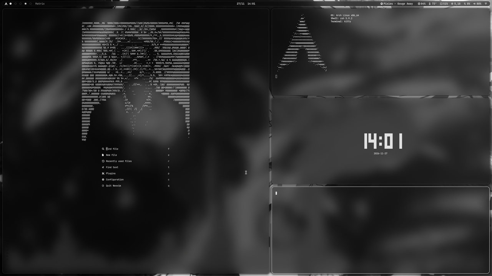
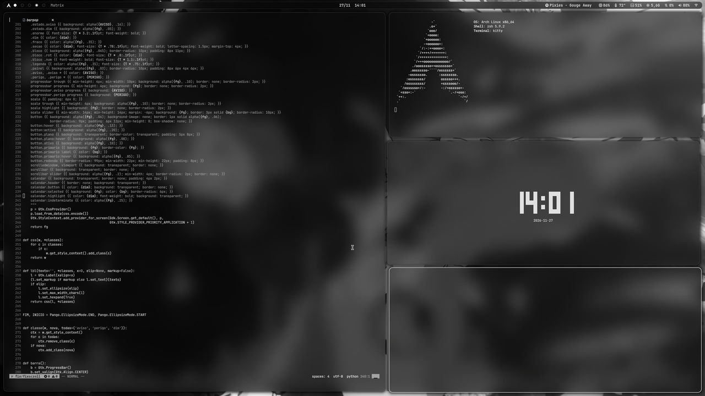
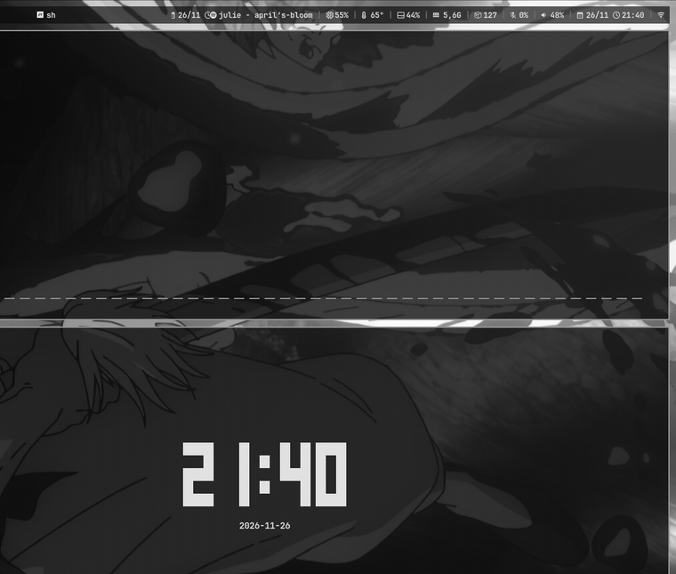

<div align="center">
    
</div><br>

<div align="center">

## /dotfiles

</div>

<div align=center>


</div>

<div align="center">
<table>
<tr>
<td>

```Go
†††    setup / hyprland     †††
-------------------------------
╭─ distro      -> arch linux
├─ editor      -> neovim
├─ browser     -> brave
├─ shell       -> zsh
╰─ monitor     -> barpop

╭─ music       -> cmus, spotify
├─ compositor  -> hyprland (blur, fades)
├─ notify      -> dunst
├─ media       -> mpv
├─ background  -> cava
╰─ files       -> ranger

╭─ wm          -> hyprland (lua config)
├─ bar         -> waybar
├─ terminal    -> kitty
├─ launcher    -> fuzzel
├─ wallpaper   -> awww
├─ lock        -> gtk-session-lock + webkit
├─ theme       -> pywal, b&w
╰─ font        -> jetbrainsmono
```

</td>
<td>
<br>

</td>
</tr>
</table>
</div>

<p align="center">
    
</p>
<br>


  **warning**

  this is my personal arch linux setup, running on three monitors. use it as inspiration: there is no guarantee it will work as-is on your machine.

<br>

<div align=center>

```ocaml
††† hyprland 時
```
</div>

The config is a single Lua file, `.config/hypr/hyprland.lua`, which Hyprland 0.57 reads. It came from dwm, so it behaves like dwm:

- Each monitor has its own workspaces 1–5. `Super + 1–5` switches on the monitor under focus, and Waybar shows the same 1–5 on every screen.
- The layouts keep the dwm keys: `Super + T` tile, `Super + U` centered master, `Super + F` / `O` dwindle, `Super + Space` toggles the last one.
- Cava runs behind the windows on the main monitor (LG), as a kitty panel on the background layer. `fundo-vigia` listens to Hyprland's event socket and redraws cava and the wallpaper when a monitor is plugged or unplugged.
- If the main monitor goes to another computer, `fundo-vigia` moves the right monitor next to the laptop so the cursor can still cross.
- Scripts written for X (`monitores`, `fundo`, `tela-desliga`) check for Hyprland and hand over to their versions in `.local/bin/wayland/`.
- The lock screen (`Super + F11`) uses `ext-session-lock` through gtk-session-lock. Each monitor gets its own WebKit page, and the password goes through PAM.

<details>
<summary><b>keybinds 麗</b></summary>
<br>

| Keybind | Action |
|---------|--------|
| `Super + Enter` | Kitty |
| `Super + Shift + Enter` | Scratchpad terminal |
| `Super + P` | Fuzzel |
| `Super + Shift + P` | Power menu |
| `Super + 1–5` | Workspace on the focused monitor |
| `Super + Tab` | Previous workspace |
| `Super + Shift + Q` | Close window |
| `Super + T / U / F / O` | Tile / centered master / dwindle |
| `Super + M` | Maximize |
| `Super + Shift + Space` | Float |
| `Super + H / L` | Shrink / grow master |
| `Super + Ctrl + ← / →` | Focus monitor |
| `Super + Alt + ← / →` | Send window to monitor |
| `Super + Alt + 1 / 2 / 3` | Turn a monitor off and on |
| `Super + G` | Toggle glass effects |
| `Super + B` | Toggle bar |
| `Super + = / -` | Gaps |
| `Ctrl + Shift + A / S` | More / less transparency |
| `Print` / `Super + Print` / `Shift + Print` | Copy region / save full screenshot / copy text (OCR) |
| `Super + Shift + Y` | Clipboard history |
| `Super + Shift + R` | Reload config |
| `Super + F11` | Lock screen |

</details>

<div align=center>

```ocaml
††† barpop 窓
```
</div>

<p align="center">
    
</p>

Click a block on Waybar and it opens a popup. A single script, `~/.local/bin/barpop` (Python + GTK 3 + gtk-layer-shell), draws all of them. The data comes from `/proc`, `/sys` and tools like `wpctl`, `iw` and `df`; btop and htop are not needed.

<details>
<summary><b>what each popup shows 火</b></summary>
<br>

| Block | Popup |
|-------|-------|
| CPU | 5-minute graph, frequency, load, processes, uptime, per-thread bars and the 5 heaviest processes right now |
| Temperature | 5-minute graph, every core with its bar, chipset and battery |
| Memory | 5-minute graph, RAM and swap, cache and the 5 programs using the most |
| Disk | live read/write graph and space of every partition |
| Updates | package list (repo + AUR) with the new version, scrollable, and an *Update now* button |
| Volume / Mic | volume slider, mute button, device picker and a shortcut to the mixer |
| Network | live download/upload, latency, Wi-Fi signal and router |
| VPN | Mullvad state with connect/disconnect, Tailscale and the devices on the tailnet |
| cmus / Spotify | song, artist, cover, progress and controls |
| Date | big clock, calendar with week numbers and UTC time |

</details>

<details>
<summary><b>how it works 水</b></summary>
<br>

- It opens under the block you clicked. The mouse position is read before GTK loads, so moving the mouse right after the click doesn't throw it off.
- Click the same block again to close it, or another block to swap. Moving the mouse away also closes it.
- Kitty and barpop share opacity through `~/.cache/st-alpha`. Hyprland handles blur and fades.
- Colors follow pywal.
- The CPU, temperature and memory blocks save their last 60 values (5 minutes) to `$XDG_RUNTIME_DIR/barhist/`, so the graphs already have data when the popup opens.
- The updates block caches the package list. The popup shows the cached list at once and runs `checkupdates` and `yay -Qua` again in the background.

</details>

<p align="center">
    
</p>
<br>

<div align=center>

```ocaml
††† installation 魅
```
</div>

<details>
<summary><b>manual</b></summary>
<br>

  Assuming your **AUR Helper** is [yay](https://github.com/Jguer/yay).

```sh
yay -S hyprland xdg-desktop-portal-hyprland xorg-xwayland qt6-wayland hyprlock hyprsunset hyprpicker \
  hyprpolkitagent waybar kitty fuzzel awww grim slurp wl-clipboard cliphist wf-recorder dunst udiskie \
  python-gobject python-pillow gtk3 gtk-layer-shell gtk-session-lock webkit2gtk-4.1 xsecurelock \
  zsh neovim ranger btop neofetch cava tty-clock-git cmatrix-git playerctl mpv cmus \
  pipewire pipewire-pulse wireplumber python-pywal ttf-jetbrains-mono-nerd bibata-cursor-theme-bin \
  tesseract tesseract-data-eng tesseract-data-por brave-bin
```

```sh
git clone https://github.com/francosec/dotfiles.git
```

  Create [symbolic links](https://www.freecodecamp.org/news/linux-ln-how-to-create-a-symbolic-link-in-linux-example-bash-command/) to the files/directories you need. `.local/bin/wayland` has to come before `.local/bin` in `PATH`.

  Log in on tty1 and `.config/zsh/.zprofile` starts Hyprland. Press `t` in the first 2 seconds to stay in the terminal. Set your monitors at the top of `hyprland.lua`.

</details>

<details>
<summary><b>automatic</b></summary>
<br>

  Install [git](https://github.com/git/git), clone this repo and run the script. It installs the packages, links the configs (old ones go to `~/.bkp_config`) and runs pywal.

```sh
sudo pacman -Syu git
git clone https://github.com/francosec/dotfiles.git
cd dotfiles/
chmod +x install.sh
./install.sh
```

</details>

<details>
<summary><b>fresh arch with luks</b></summary>
<br>

  `instalar-arch-luks.sh` installs Arch with two LUKS2 volumes (`/boot`, opened by GRUB, and `/`, opened by the initramfs), then runs this build at the end. Run it from the Arch live ISO.

```sh
bash instalar-arch-luks.sh /dev/sdX   # WIPES the whole disk
```

  Pass the disk, or set `MODELO_ALVO` to pick it by model. It refuses any disk with an NTFS partition.

</details>

<br>


